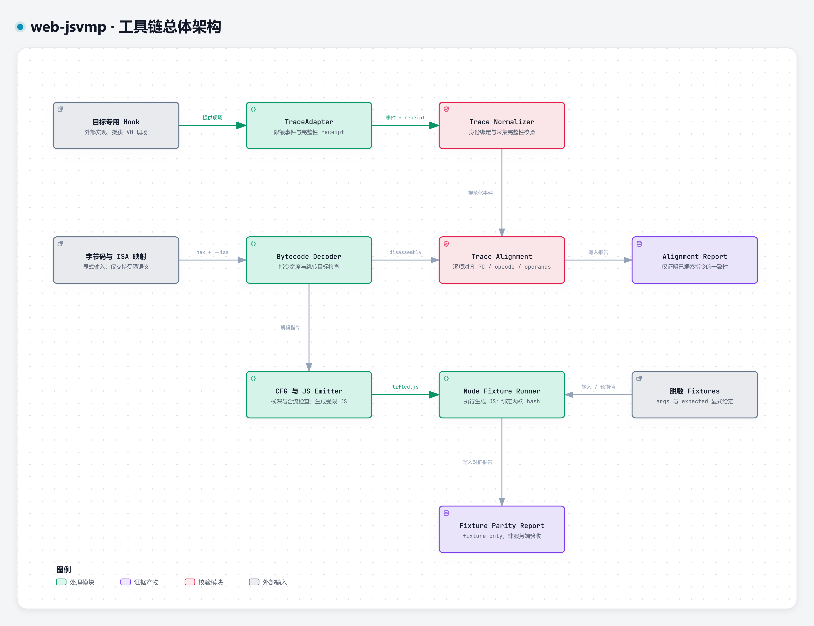
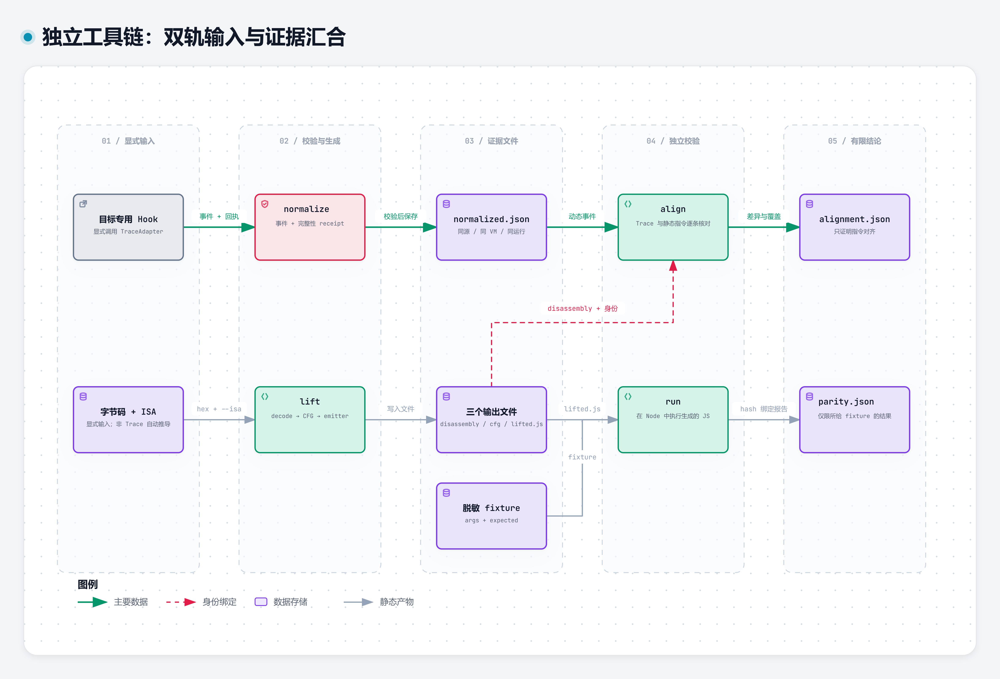
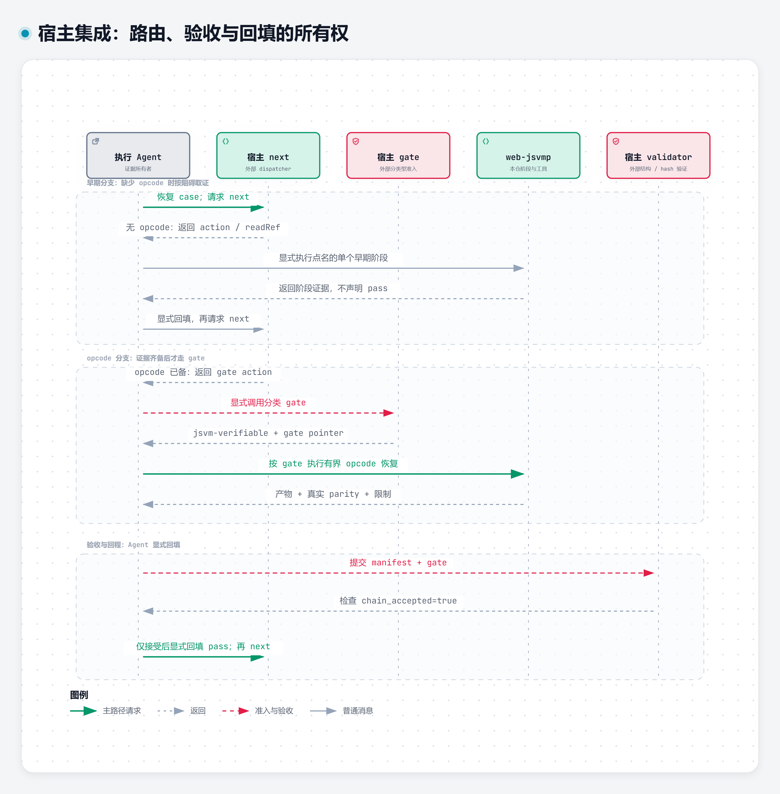

# Web JSVMP Analysis Skill

**面向 Web JavaScript 自定义虚拟机的分阶段分析方法与有界恢复工具链。**

本项目将请求入口定位、解释器分型、观测完整性、字节码解码、CFG 检查与 fixture 对拍组织为可追溯的分析过程。它既可作为独立 CLI 使用，也可作为 Web 逆向主线中的专用 skill 集成；两种方式共享工具，不共享未经证明的成功声明。

当前实现面向已识别、可显式描述的受限 ISA。它不是通用 JSVMP 去虚拟化器，不自动定位 VM、猜测未知 handler 或恢复任意 JavaScript。自动化回归使用合成样本，尚未将真实困难目标或线上题目通过作为已完成能力。

## 文档导航

- [系统架构](#系统架构)：组件职责、证据边界与能力范围。
- [快速开始](#快速开始)：无需宿主工程的可运行示例。
- [分阶段分析](#分阶段分析)：按当前阻碍选择阶段，而非固定流水线。
- [端到端合成演示](#端到端合成演示)：采集、normalize、lift、align 与 parity。
- [CLI 与产物合同](#cli-与产物合同)：参数、报告字段、退出码与资源边界。
- [自定义 ISA 与语义](#自定义-isa-与语义)：支持的编码、指令及实现限制。
- [宿主集成](#宿主集成)：gitlink、dispatcher、gate 与共享 validator。
- [故障定位](#故障定位)、[开发与维护](#开发与维护)、[许可证与来源](#许可证与来源)。

## 系统架构



[交互架构图](docs/diagrams/architecture.html) · [SVG](docs/diagrams/architecture.svg) · [Archify 源文件](docs/diagrams/architecture.json)

图示的 HTML 为独立交互文件，GitHub 仓库页面不会直接运行；克隆后可在本地浏览器打开。PNG 用于文档预览，SVG 适合放大阅读，JSON 用于再生成与维护。

| 组件 | 职责 | 不承担的工作 |
| --- | --- | --- |
| 阶段 references | 从当前阻碍选择下一项有界实验 | 自动完成整站逆向或管理第二套案件状态 |
| 目标专用 hook | 从实际 dispatcher / handler 提供指令观察 | 本仓库不提供任意保护器通用 hook |
| `probe_adapter.js` | 事件封装、身份字段、序号与采集计数 receipt | 自动发现 VM、自动证明观测无扰动 |
| `normalize` | 校验 NDJSON、统一身份并按 `seq` 排序 | 从调用计数或缺失值推断 opcode trace |
| `decode` / `lift` | 解码已声明 ISA；构建基本块、检查栈深、生成 JS | 推断未知语义、结构化 AST 还原或 CFG 优化 |
| `align` | 逐事件比对静态 PC、opcode 与 operands | 检查栈值计算、CFG 动态路径或全部分支覆盖 |
| `run` | 在 Node 中比较生成函数与 fixture 期望值 | 原 VM 对拍、线上请求等价性或服务端验收 |

应分开理解四种证据：**事件合同成立、指令对齐、fixture 一致、业务通过**。前一项不会自动推出后一项；报告的 `claim_scope` 是可声明的边界，不是装饰字段。

## 快速开始

### 环境

- Python 3.10 或更高版本；仅使用标准库，无需安装 pip 依赖。
- Node.js 20 或更高版本；用于 adapter 演示、生成 JS 执行及相关测试。
- `python` 与 `node` 位于 `PATH`。CLI 可用 `--node <executable>` 指定 Node，测试可用 `JSVMP_NODE` 环境变量指定。
- 工具不会自动安装依赖、启动浏览器或下载目标脚本。以下命令均从独立仓库根目录运行。

```sh
git clone https://github.com/Facetomyself/web-jsvmp.git
cd web-jsvmp
python -m unittest discover -s tests -v
python scripts/jsvmp_toolchain.py lift 0200010300000010ff --out-dir artifacts/add3
python scripts/jsvmp_toolchain.py run artifacts/add3/lifted.js tests/fixtures/add3.parity.json --node node --out artifacts/add3/parity.json
python -c "import json; r=json.load(open('artifacts/add3/parity.json',encoding='utf-8')); assert r['passed'] and r['claim_scope']=='fixture-only'; print('fixture parity: OK')"
```

这段字节码是教学用的 `return arg0 + 3`，并非实际保护器样本。fixture 包含正数、负数及超过有符号 32-bit 上界的加法结果；`ADD` 使用 JavaScript `+`，不是自动截断的 32-bit 加法。

`lift` 生成 `disassembly.json`、`cfg.json` 与 `lifted.js`。`run` 写入带 hash、Node 版本及逐项结果的报告。**同时检查退出码与报告中的 `passed`；exit 0 仅表示命令完成，不表示 fixture 全通过。**

## 分阶段分析

JSVMP 分析通常难在证据边界，而不只是缺一个反编译器：请求尚未发出、算法位于宿主原语、字节码动态生成和 opcode 不明，需要的是不同实验。因此 skill 按当前阻碍选择单个阶段，不要求每个目标从头跑完五个阶段。

| 阶段 / `jsvmBlocker` | 本阶段回答的问题 | 说明 |
| --- | --- | --- |
| `host-primitive` | 能否先闭合宿主原语，避免无谓拆解 VM？ | [host-primitive.md](references/host-primitive.md) |
| `interpreter-structure` | 当前是栈式、寄存器式还是多层解释器？入口在哪里？ | [interpreter-structure.md](references/interpreter-structure.md) |
| `chaos-vm-instrument` | 在现有执行边界，能否补齐有用且有界的观察？ | [chaos-vm-instrument.md](references/chaos-vm-instrument.md) |
| `opcode-recovery` | 已知编码与 runtime trace 是否足以进入局部语义恢复？ | [opcode-recovery.md](references/opcode-recovery.md) / [toolchain.md](references/toolchain.md) |
| `variant-failure` | 失败来自哪一层？修复后是否实际换了资源或运行边界？ | [variant-failure.md](references/variant-failure.md) |

以下是阶段内分支，不是新的 blocker 或独立状态机：[请求与 dispatcher 定位](references/request-dispatcher.md)、[动态字节码](references/dynamic-bytecode.md)、[所在层指纹](references/layer-fingerprint.md)、[观测完整性](references/observation-integrity.md)。

没有 opcode、operand 与 stack 观察时，应停留在取证阶段。`Reflect.apply` 计数、handler 调用总数、只有 opcode byte 的文件，不应包装成符合本工具合同的指令 trace。未知值不能用空数组冒充已观察状态。

## 端到端合成演示



[交互流程图](docs/diagrams/pipeline.html) · [SVG](docs/diagrams/pipeline.svg) · [Archify 源文件](docs/diagrams/pipeline.json)

### 1. 生成演示 trace 与 receipt

先创建工作目录，将下列代码保存为 `artifacts/add3/capture.cjs`。它**人工提供已知示例的四条事件**，仅用于演示工具合同；真实目标必须改由实际取指、解码和执行点提供观察。演示中的 64 个 `a` 是身份占位符，不是目标源码的真实 SHA-256。

```sh
python -c "from pathlib import Path; Path('artifacts/add3').mkdir(parents=True,exist_ok=True)"
```

```javascript
const fs = require('node:fs');
const path = require('node:path');
const { TraceAdapter } = require('../../scripts/probe_adapter.js');
const rows = [];
const adapter = new TraceAdapter({
  runId: 'synthetic-add3-r1',
  sourceSha256: 'a'.repeat(64),
  vmId: 'vm-1',
  maxEvents: 100,
  sink: row => rows.push(JSON.stringify(row)),
});
adapter.emit({ pc: 0, opcode: 'LOAD_ARG', operands: [0], stackBefore: [], stackAfter: [7] });
adapter.emit({ pc: 2, opcode: 'PUSH_I32', operands: [3], stackBefore: [7], stackAfter: [7, 3] });
adapter.emit({ pc: 7, opcode: 'ADD', operands: [], stackBefore: [7, 3], stackAfter: [10] });
adapter.emit({ pc: 8, opcode: 'RET', operands: [], stackBefore: [10], stackAfter: [] });
fs.writeFileSync(path.join(__dirname, 'trace.ndjson'), rows.join('\n') + '\n', 'utf8');
fs.writeFileSync(path.join(__dirname, 'collection.json'), JSON.stringify(adapter.receipt(), null, 2) + '\n', 'utf8');
```

`TraceAdapter.emit()` 的字段采用 `stackBefore` / `stackAfter`；输出事件采用 `stack_before` / `stack_after`。可选的 `hostCalls`、`writes`、`branchTaken`、`timestampNs` 会保留在事件中，但当前恢复引擎不会解释它们的语义。

receipt 的预期形状如下，身份必须与每条事件一致：

```json
{
  "schema_version": 1,
  "run_id": "synthetic-add3-r1",
  "source_sha256": "aaaaaaaaaaaaaaaaaaaaaaaaaaaaaaaaaaaaaaaaaaaaaaaaaaaaaaaaaaaaaaaa",
  "vm_id": "vm-1",
  "emitted": 4,
  "dropped": 0,
  "truncated": false
}
```

### 2. 执行完整命令序列

```sh
node artifacts/add3/capture.cjs
python scripts/jsvmp_toolchain.py normalize artifacts/add3/trace.ndjson --receipt artifacts/add3/collection.json --out artifacts/add3/normalized.json
python scripts/jsvmp_toolchain.py decode 0200010300000010ff --out artifacts/add3/decoded.json
python scripts/jsvmp_toolchain.py lift 0200010300000010ff --function vm --out-dir artifacts/add3/lift
python scripts/jsvmp_toolchain.py align artifacts/add3/normalized.json artifacts/add3/lift/disassembly.json --source-sha256 aaaaaaaaaaaaaaaaaaaaaaaaaaaaaaaaaaaaaaaaaaaaaaaaaaaaaaaaaaaaaaaa --vm-id vm-1 --run-id synthetic-add3-r1 --out artifacts/add3/alignment.json
python scripts/jsvmp_toolchain.py run artifacts/add3/lift/lifted.js tests/fixtures/add3.parity.json --node node --out artifacts/add3/parity.json
python -c "import json; a=json.load(open('artifacts/add3/alignment.json',encoding='utf-8')); p=json.load(open('artifacts/add3/parity.json',encoding='utf-8')); assert a['aligned'] and p['passed']; print(a['claim_scope'],p['claim_scope'])"
```

`decode` 是独立检查命令，`lift` 本身会再次解码，不依赖前一步的 `decoded.json`。示例的预期报告为 `aligned=true`、`mismatches=[]`、`unobserved_static_pcs=[]` 和 `passed=true`；它们分别只支持 `trace-instruction-alignment-only` 与 `fixture-only` 声明。

完整链路由 `test_adapter_normalize_lift_align_and_run_pipeline` 覆盖。合成例子证明合同和工具之间能够连通，不证明任意真实 VM 可被自动适配。

### 3. 真实目标需要额外保留的证据

- 源码快照、实际 hash、运行输入、VM 实例与采集窗口，及其与抽取字节码的关联依据。
- 目标 hook 的位置和语义映射来源；插桩前后的结果对照及已知观测影响。
- 来自原 VM 或可信请求边界的 fixture 来源，以及未覆盖分支、环境和副作用限制。
- 原始 NDJSON、采集 receipt、ISA、字节码、生成物与报告，避免只保留最终 `passed`。

`source_sha256` 的一致只是在 trace、receipt 与命令参数之间核对身份字符串；当前 CLI 不会读取源码并独立证明源码、字节码与 fixture 的来源链。

## CLI 与产物合同

入口为 `python scripts/jsvmp_toolchain.py <command>`。字节码参数是**十六进制字符串本身**，不是文件路径；允许 `bytes.fromhex` 接受的空白，不接受 `0x` 前缀或 base64。所有输出路径均相对于当前工作目录解析。

| 命令 | 必填输入与参数 | 可选参数 | 主要产物 |
| --- | --- | --- | --- |
| `normalize TRACE` | UTF-8 NDJSON；`--receipt JSON --out JSON` | 无 | 排序后的事件与输入 hash |
| `decode BYTECODE_HEX` | `--out JSON` | `--isa JSON` | `disassembly.json` 结构 |
| `lift BYTECODE_HEX` | `--out-dir DIR` | `--isa JSON`、`--function NAME`（默认 `vm`） | `disassembly.json`、`cfg.json`、`lifted.js` |
| `align TRACE DISASSEMBLY` | normalized JSON；`--source-sha256 HASH --vm-id ID --run-id ID --out JSON` | 无 | 动态事件与静态指令对齐报告 |
| `run JS FIXTURE` | `--out JSON` | `--node EXECUTABLE`（默认 `node`） | fixture parity 报告 |

### 退出码与自动化调用

- 正常完成返回 **0**；`align` 的 `aligned=false`、`run` 的 `passed=false` 仍可返回 0，调用方必须读报告。
- 已捕获的合同、文件、解码、Node 子进程或超时错误返回 **2**，stderr 输出 `{"status":"insufficient-evidence-or-error","error":"..."}`。
- 参数解析错误也返回 2，但使用 argparse 的文本格式；不是每种失败都有 JSON 错误对象。
- 成功结果打印到 stdout，同时按指定路径落盘；`lift` stdout 是产物摘要，不是全部文件正文。
- 输出不是事务式目录替换；失败后应核对文件时间与本次输入，不能把旧报告视作新结果。

### 关键报告字段

| 产物 | 关键字段 | 解读 |
| --- | --- | --- |
| normalized trace | `schema_version`、`run_id`、`source_sha256`、`vm_id`、`input_sha256`、`events` | `input_sha256` 是原始 NDJSON 字节 hash，`events` 是排序后的数组 |
| disassembly | `bytecode_hex`、`byte_length`、`instructions`、`instruction_widths` | 每条指令含 `pc`、`next_pc`、`opcode`、`opcode_name`、`opcode_byte`、`operands`、`width` |
| CFG | `entry`、`blocks`、`pc_to_block`、`stack_depth_at_entry`、`max_stack_depth`、`coverage` | `coverage.reachable_blocks` 是静态可达 block ID 数组，不是运行覆盖率 |
| alignment | `trace_events`、`covered_static_pcs`、`unobserved_static_pcs`、`mismatches`、`aligned`、`claim_scope` | mismatch 原因为 `pc-not-in-disassembly`、`opcode-mismatch` 或 `operand-mismatch` |
| parity | `engine`、`node_version`、`generated_js_sha256`、`fixture_sha256`、`fixtures`、`passed`、`claim_scope` | 每项 fixture 含 `actual`、`expected`、`pass` |

自定义 ISA 时，以 `instructions[].width` 为单条指令编码宽度依据；顶层 `instruction_widths` 当前仍列出内置 canonical ISA 的宽度，不是自定义映射的完整摘要。

### Trace 校验与资源边界

每条事件必需 `run_id / source_sha256 / vm_id / seq / pc / opcode / operands / stack_before / stack_after`。schema 为 [trace-event.schema.json](schemas/trace-event.schema.json)；normalizer 缺省补 `schema_version=1`，不依赖外部 JSON Schema 验证库，执行的是脚本内的检查。

身份须非空且一致，源码 hash 为 64 位小写十六进制；`seq` 为非负且唯一，重复 PC 允许。工具按 `seq` 排序，但不要求序号连续；保留数组不等于验证栈值转换正确。receipt 必须满足身份一致、`emitted` 等于行数、`dropped=0`、`truncated=false`。

| 边界 | 当前值 / 行为 |
| --- | --- |
| Adapter 默认 `maxEvents` | 100,000；超过后 `emit` 返回 false，累计 dropped，receipt 标记截断 |
| Normalizer 输入 | 原始文件最大 128 MiB；单事件行最大 1 MiB；最多 250,000 条事件 |
| Bytecode | 最大 1 MiB；未知 opcode、截断 operand、非指令起点分支会拒绝 |
| 生成 JS | 每次函数调用最多 1,000,000 次 dispatch，超过抛出 `VM step limit` |
| Node runner | 主 fixture 子进程超时 30 秒；不是隔离执行沙箱 |

Adapter 的 receipt 记录 sink 的事件数量，不保证 sink 已可靠写盘，也不证明实际 VM 未遗漏观察。集成方仍需负责传输、落盘、脱敏和观测完整性检查。

## 自定义 ISA 与语义

### 指令表

| Canonical operation | 默认 byte / 编码 | 栈变化 | 当前 emitter 语义 |
| --- | --- | --- | --- |
| `PUSH_I32` | `0x01` + `i32le` | 0 → 1 | 压入有符号 32-bit 立即数 |
| `LOAD_ARG` | `0x02` + `u8` | 0 → 1 | 读取 `args[index]` |
| `ADD` | `0x10` | 2 → 1 | JS `a + b`，可发生字符串拼接 |
| `XOR` | `0x11` | 2 → 1 | `Number` 转换后按 32-bit 位运算异或 |
| `ROTL` | `0x12` + `u8` | 1 → 1 | 32-bit 循环左移，count 使用 `& 31` |
| `MUL32` | `0x13` | 2 → 1 | `Math.imul(a, b)` |
| `JMP` | `0x20` + `u16le` | 0 → 0 | 跳转到绝对 byte PC |
| `JZ` | `0x21` + `u16le` | 1 → 0 | 弹栈后按 JS `!value` 分支，不限于数值零 |
| `RET` | `0xff` | 1 → 0 | 返回栈顶值 |

CFG 检查静态入口可达块的栈下溢与 merge 栈深一致性；它不是全路径动态值检查，也不优化、删除或补全未观察分支。codegen 保留 PC-dispatch，不宣称生成原始源码或结构化 AST。

### 映射文件

将下面的 JSON 保存为 `artifacts/add3/isa.json`，以不同 opcode byte 表达同一受限程序：

```json
{
  "opcodes": [
    { "name": "ARG", "byte": 128, "semantic": "LOAD_ARG", "operands": ["u8"] },
    { "name": "I32", "byte": 129, "semantic": "PUSH_I32", "operands": ["i32le"] },
    { "name": "PLUS", "byte": 130, "semantic": "ADD", "operands": [] },
    { "name": "RETURN", "byte": 255, "semantic": "RET", "operands": [] }
  ]
}
```

```sh
python scripts/jsvmp_toolchain.py lift 8000810300000082ff --isa artifacts/add3/isa.json --out-dir artifacts/add3/custom
python scripts/jsvmp_toolchain.py run artifacts/add3/custom/lifted.js tests/fixtures/add3.parity.json --out artifacts/add3/custom/parity.json
```

`name` 与 `byte` 应各自唯一，`byte` 使用 JSON 十进制整数 0–255；`semantic` 只能取上表名称。operand 编码仅支持 `u8 / u16le / i32le`，并须匹配该语义：分支固定为一个 `u16le`，`PUSH_I32` 为 `i32le`，`LOAD_ARG / ROTL` 为 `u8`，其余无编码 operand。映射是显式声明，不是 opcode 猜测；`align` 接受 canonical 名称或对应 `opcode_name`。

### 不支持或不应扩大的语义

动态跳转、调用/异常、闭包、对象/Proxy/getter/`this` 副作用、自修改代码与 WASM 尚无对应 IR；不得将这些 handler 强行映射到最相似的算术操作。当前 fixture runner 使用 JSON 输入及 `JSON.stringify(actual) === JSON.stringify(expected)` 比较，不能作为 BigInt、对象身份、循环引用、NaN/undefined 等完整 JS 值模型的验收器。函数抛出的异常会转换成 `{ "error": "Name: message" }` 后参与 fixture 比较，不等于异常语义恢复已实现。

## 宿主集成



[交互集成图](docs/diagrams/integration.html) · [SVG](docs/diagrams/integration.svg) · [Archify 源文件](docs/diagrams/integration.json)

独立 CLI 不需要宿主。阶段回执用 `python scripts/jsvmp_toolchain.py stage <name>`，说明见 [toolchain.md](references/toolchain.md)。交给宿主验收时只走 [project-adapter.md](references/project-adapter.md)，它不写 `chain_accepted`。宿主调度细节在 [host-integration.md](references/host-integration.md)。不得把本地 `passed=true` 直接改写为宿主成功。

### Gitlink 维护

```sh
git submodule add https://github.com/Facetomyself/web-jsvmp.git skill/web-jsvmp
git submodule update --init --recursive
```

`submodule add` 仅适用于目标路径不存在或已完成迁移的情况。已有普通目录应先保留变更，再由宿主维护者迁移索引。子仓单独审阅和发布，主仓提交 gitlink 指向的子仓 commit；更新引用应与宿主合同兼容性检查一起进行，不依赖浮动分支自动升级。

### 外部组件与回程合同

| 宿主组件（不随本仓库发布） | 作用 |
| --- | --- |
| `docs/agent-architecture.md` | 宿主调度、子代理与状态维护规则 |
| `web-reverse` / `web_case.py` | case/facts 与 `next` dispatcher |
| `web-deobfuscation` | 分类 gate、共享 manifest schema、validator |
| `article/web-reverse/` | 可选方法来源，不是独立 CLI 运行依赖 |

共享验收命令由宿主提供：

```sh
python skill/web-deobfuscation/scripts/validate_web_deobfuscation_case.py --manifest case.json --gate gate.json --report validation.json
```

本仓库不复制共享 schema 或另建案件状态机。返回 manifest、validation、证据路径、`claim_scope`、限制和原会话句柄；由宿主证据所有者显式回填 facts。`deobfuscation=pass` 要求共享报告的 `chain_accepted=true`，仅 `ok=true` 不足；validator 的证据结构验收也不能替代真实语义对拍与业务 readback。独立运行缺少宿主时，不应生成这些宿主成功声明。

## 故障定位

| 现象 | 优先核对 | 正确处理边界 |
| --- | --- | --- |
| `missing required fields` | 是否只有 API 计数或 handler 总数？ | 回到实际取指点采集，不能补造 opcode 行 |
| `trace incomplete` | receipt 身份、计数、dropped、truncated | 修复采集/传输并重新取证，不删除截断标记 |
| `unknown opcode` / `truncated ... operand` | 是否取错 bytecode、编码或资源版本？ | 保存 first divergence；提供有证据的 ISA 映射 |
| branch 目标非指令起点 | PC 单位、绝对/相对跳转、operand endian | 当前仅支持绝对 `u16le` byte PC |
| `stack underflow` / merge depth 不一致 | 入栈模型、handler 语义与控制流 | 不用平衡栈补丁掩盖映射错误 |
| `aligned=false` | `mismatches` 的 seq/PC 与 operands | 对照原始观察；不是增加 fixture 就能解决 |
| aligned 但有 unobserved PC | trace 实际经过的分支 | 声明未观察范围，不把静态可达当动态覆盖 |
| exit 0 但 `passed=false` | 逐项 actual/expected、输入和运行版本 | 保留 first divergence，不能报告 parity 通过 |
| `VM step limit` / Node 超时 | 循环、错误分支、缺失返回 | 核对语义与终止条件，不先放大资源界限 |
| Node 测试被 skip | PATH 或 `JSVMP_NODE` | 补齐运行时后重测，skip 不是完整链路通过 |
| 真实请求仍失败 | fixture 来源、宿主状态与请求边界 | 回到宿主主线；本地 fixture 不能代替业务验收 |

## 开发与维护

```text
SKILL.md                  阶段入口与宿主路由合同
references/               分阶段说明、工具合同及外部工具边界
schemas/                  探针事件结构
scripts/                  Python CLI 与 JavaScript 事件 sink
tests/fixtures/           合成 fixture 与无效输入样本
docs/diagrams/            PNG / SVG / 交互 HTML / Archify JSON
.github/workflows/        Windows / Linux 测试配置
```

```sh
python -m unittest discover -s tests -v
python scripts/jsvmp_toolchain.py --help
node --check scripts/probe_adapter.js
```

回归覆盖解码边界、自定义 ISA、分支 CFG、身份与 operand 对齐、采集截断、调用计数拒绝、JS 生成及 fixture parity。缺少 Node 时执行相关测试会 skip。CI 配置包含 Windows / Linux、Python 3.10 / 3.13、Node 20；配置存在不等于本次远端 CI 已通过。

新增语义应同时明确 encoding、栈效果、JS 值转换、分支/副作用限制，并补正向与 first-divergence 负向回归。改动 trace 合同或报告字段时，应同步更新 schema、CLI 文档和宿主兼容性检查。更新图示时同时保留候选 JSON、可交互 HTML、SVG 与 README 预览 PNG，按 Archify 的验证回执区分自动检查与实际看图结论。

## 许可证与来源

本项目采用 [MIT License](LICENSE)。本许可证适用于本仓库由 Facetomyself 发布的代码、文档、测试、示例和图示资产；第三方工具、外部参考资料及 Archify 生成器/运行时组件仍以各自许可证和归属声明为准。仓库不附带真实目标脚本、用户会话、Cookie、浏览器身份或业务原始回执；提交实例应使用可公开的合成数据，并清楚标明证据来源及声明范围。

外部项目仅作方法参考或可选工作站，详见 [external-tools.md](references/external-tools.md)。本仓库不附带真实目标脚本、用户会话、Cookie、浏览器身份或业务原始回执；提交实例应使用可公开的合成数据，并清楚标明证据来源及声明范围。
